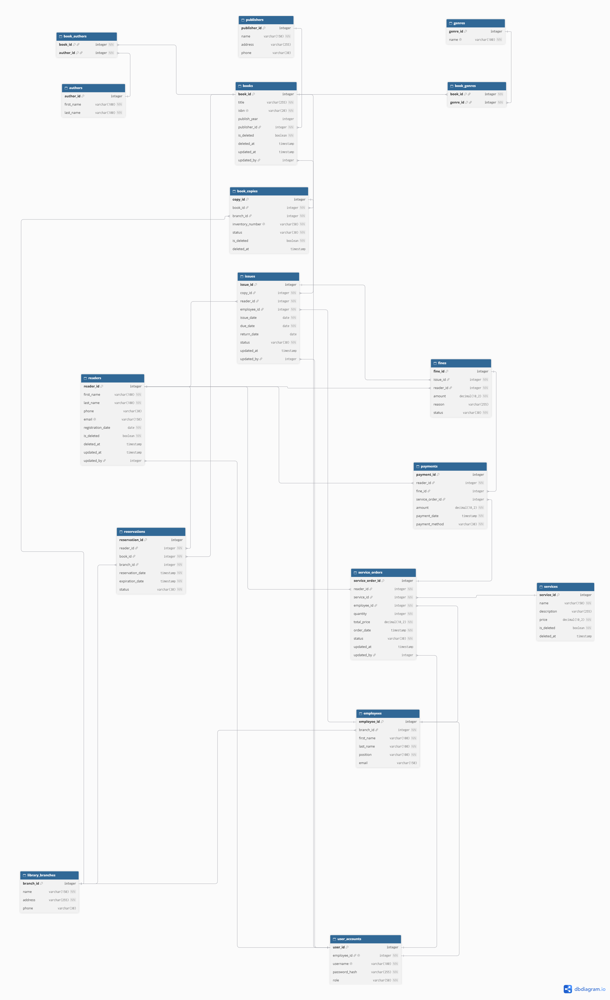

# Лабораторна робота: використання NoSQL у системі управління бібліотекою

## Мета роботи

Дослідити основні типи NoSQL-баз даних, обґрунтувати використання нереляційного зберігання для окремих задач бібліотечної системи, реалізувати відповідні операції в PostgreSQL, MongoDB та Redis і порівняти швидкодію SQL- та NoSQL-запитів.

## 1. Теоретичні відомості

NoSQL — узагальнена назва баз даних, що використовують моделі зберігання, відмінні від класичної реляційної. Основні типи:

| Тип | Модель даних | Приклади | Типові задачі |
|---|---|---|---|
| Документний | Документи з полями та вкладеними структурами | MongoDB | Каталоги, неоднорідні дані |
| Ключ–значення | Значення, доступне за ключем | Redis | Кешування, лічильники, швидке читання |
| Графовий | Вузли та ребра між ними | Neo4j | Рекомендації, складні зв'язки |
| Колонковий / wide-column | Рядки з гнучкими наборами колонок | Cassandra | Масштабовані розподілені записи |

NoSQL не є універсальною заміною SQL. Вибір технології залежить від структури даних, характеру запитів, вимог до узгодженості та оновлень.

## 2. Предметна область та обґрунтування вибору

Система управління бібліотекою містить інформацію про книги, авторів, жанри, видавництва, окремі примірники, читачів, видачі, бронювання та штрафи.

**PostgreSQL** використовується як основна реляційна база. Пов'язані сутності зберігаються в окремих таблицях, а операції видачі й повернення книг потребують узгоджених змін.

**MongoDB** обрано для каталогу книг: назву, ISBN, рік видання, видавництво, авторів, жанри й кількість доступних примірників можна читати як один документ. Це зменшує потребу в об'єднанні кількох таблиць для типового перегляду каталогу. Водночас дубльовані поля необхідно актуалізувати при змінах у SQL-базі.

**Redis** використано для швидкого доступу до кількості доступних примірників за ідентифікатором книги. Він виступає допоміжним сховищем типу «ключ–значення», а не замінює транзакційну модель видачі книг у PostgreSQL.

### Реляційна схема



Основні таблиці каталогу: `books`, `authors`, `genres`, `publishers`, `book_authors`, `book_genres`, `book_copies`.

## 3. Реалізація в PostgreSQL і MongoDB

У PostgreSQL інформація про книгу розділена між кількома таблицями. У MongoDB документ колекції `books` містить поля `book_id`, `title`, `isbn`, `publish_year`, `publisher`, масиви `authors` та `genres`, а також `available_copies`.

### Приклад структури документа

```json
{
  "book_id": 3,
  "title": "Book 3",
  "isbn": "333333",
  "publish_year": 2010,
  "publisher": "Publisher 1",
  "authors": ["..."] ,
  "genres": ["..."],
  "available_copies": 0
}
```

Тут `...` позначає приклад вмісту масивів; точні значення залежать від записів початкової SQL-бази.


### Порівняння запитів

**Пошук книги за ID**

PostgreSQL:

```sql
SELECT * FROM books WHERE book_id = 1;
```

MongoDB (фільтр):

```json
{"book_id": 1}
```


**Книги після 2005 року**

PostgreSQL:

```sql
SELECT * FROM books
WHERE publish_year > 2005 AND is_deleted = FALSE;
```

MongoDB:

```json
{"publish_year": {"$gt": 2005}}
```


**Книги з доступними примірниками**

PostgreSQL:

```sql
SELECT b.book_id, b.title, COUNT(bc.copy_id) AS available_copies
FROM books b
JOIN book_copies bc ON bc.book_id = b.book_id
WHERE bc.status = 'available'
  AND bc.is_deleted = FALSE
  AND b.is_deleted = FALSE
GROUP BY b.book_id, b.title;
```

MongoDB:

```json
{"available_copies": {"$gt": 0}}
```


Відмінність: SQL-запит обчислює кількість за записами примірників, а MongoDB фільтрує попередньо збережене агреговане значення. Для коректності прикладного застосунку це поле потрібно оновлювати при зміні доступності.

## 4. Redis: NoSQL іншого типу

Для зберігання кількості доступних примірників використовуються ключі на зразок `library:book:1:available_count`, а множина `library:books:index` містить ідентифікатори книг.

Реалізовані базові операції: збереження або зміна кількості (`StringSetAsync`), читання (`StringGetAsync`), видалення (`KeyDeleteAsync`), облік ідентифікаторів (`SetAddAsync` / `SetRemoveAsync`) та пошук книг із додатною кількістю примірників.


**Зауваження до історичного скриншота:** у первинному виводі для видаленої книги було некоректно показано старе значення. У поточному коді результат перевіряється повторним читанням після `KeyDeleteAsync`, а відсутнє значення виводиться як `not found`.

## 5. Тестування швидкодії SQL та NoSQL

### Методика

Вимірювання виконано з C# за допомогою `Stopwatch`. На початковому наборі проведено 10 прогрівів і 100 повторень запитів. Для перевірки масштабування створено **однакові тестові набори** у `benchmark_books` (PostgreSQL) та `benchmark_books` (MongoDB): 1 000, 10 000 і 30 000 записів. Для кожної операції масштабного тесту виконано 5 прогрівів і 30 вимірювань. Виводилися кількість результатів, середній час і медіана.

Тестові операції масштабування: пошук за `book_id`, підрахунок книг після 2005 року та підрахунок книг із `available_copies > 0`. У PostgreSQL використовувався `COUNT(*)`, у MongoDB — `CountDocumentsAsync()`. Створено індекси для полів пошуку.

**Обмеження експерименту:** PostgreSQL працювала локально, а MongoDB — віддалено; виміряний час включає мережеві затримки та обробку запитів клієнтським драйвером. Тому ці цифри відображають час відповіді з конкретного середовища запуску, а не ізольовану продуктивність серверів. Початковий тест також використовує інші запити (отримання рядків, а не лише підрахунок) і наведений окремо.

### Початковий набір даних

| Операція | PostgreSQL, середній час, мс | MongoDB, середній час, мс |
|---|---:|---:|
| Пошук за ID | 0,557 | 59,145 |
| Книги після 2005 року | 0,540 | 47,839 |
| Доступні книги | 0,514 | 47,793 |


### Масштабування: середній час виконання, мс

| Кількість книг | Операція | PostgreSQL | MongoDB | Збіг кількості результатів |
|---:|---|---:|---:|---|
| 1 000 | За ID | 0,483 | 46,967 | Так: 1 |
| 1 000 | Після 2005 року | 0,561 | 47,495 | Так: 537 |
| 1 000 | Доступні | 0,426 | 49,077 | Так: 834 |
| 10 000 | За ID | 0,340 | 46,314 | Так: 1 |
| 10 000 | Після 2005 року | 0,566 | 50,528 | Так: 5 425 |
| 10 000 | Доступні | 0,676 | 50,527 | Так: 8 334 |
| 30 000 | За ID | 0,357 | 47,305 | Так: 1 |
| 30 000 | Після 2005 року | 1,155 | 55,605 | Так: 16 283 |
| 30 000 | Доступні | 1,311 | 56,050 | Так: 25 000 |

<details>
<summary>Повні виводи вимірювань за обсягами</summary>

**1 000 записів**


**10 000 записів**


**30 000 записів**


</details>

### Аналіз

У всіх проведених вимірюваннях середній час відповіді локальної PostgreSQL був нижчим. Для пошуку за ID обидва рішення демонстрували невелике зростання часу зі збільшенням обсягу даних. Підрахунок записів за умовами року й доступності був чутливішим до обсягу набору. Усі порівнювані кількості результатів збіглися. Водночас порівняння не дозволяє встановити, яка СУБД швидша за однакових серверних і мережевих умов.

## 6. Структура проєкту

```text
LibraryLab/
├── database/
│   ├── library.sql
│   └── diagram_library.png
├── LibraryApp/
│   ├── LibraryApp.sln
│   └── LibraryApp/
│       ├── Data/
│       ├── Models/
│       ├── Repositories/
│       ├── Benchmarks/
│       ├── Program.cs
│       └── LibraryApp.csproj
├── screenshots/
└── README.md
```

Усі класи MongoDB, Redis та тестування розташовані у відповідних папках проєкту.

## 7. Запуск

1. Потрібні .NET 8 SDK, PostgreSQL та доступ до MongoDB і Redis.
2. Створити базу PostgreSQL `library` і відновити структуру та тестові дані з `database/library.sql`.
3. Налаштувати змінні середовища `MONGODB_URI`, `REDIS_HOST`, `REDIS_PASSWORD`, `REDIS_PORT` (за потреби) та `POSTGRES_CONNECTION_STRING` — без зберігання паролів у Git.
4. Відкрити `LibraryApp/LibraryApp.sln` у Visual Studio, відновити NuGet-пакети та запустити застосунок. Для операцій із NoSQL потрібні пакети `MongoDB.Driver` і `StackExchange.Redis`, для SQL — `Npgsql`.
5. У меню обрати: 1 — Redis; 2 — перегляд MongoDB; 3 — порівняння масштабування; 4 — імпорт із PostgreSQL; 5 — порівняння на початкових книгах; 6 — перегляд даних PostgreSQL без змін. Генератор тестів створює/очищає лише спеціальні набори `benchmark_books`; вихідні дані бібліотеки не призначені для очищення тестами.

## Висновок

У роботі досліджено моделі NoSQL-зберігання та використано два їх типи в бібліотечній системі: документну MongoDB і Redis типу «ключ–значення». Для каталогу об'єднано дані книги, авторів, жанрів, видавництва та доступності примірників. У PostgreSQL збережено нормалізовану структуру, придатну для пов'язаних операцій бібліотечного обліку. У Redis показано зберігання значень за ключем і роботу з множиною ідентифікаторів.

Практичні тести на 1 000, 10 000 і 30 000 записів підтвердили збіг результатів SQL- та MongoDB-запитів. У наявному середовищі локальна PostgreSQL показала менший час відповіді, проте віддалений спосіб доступу до MongoDB не дозволяє трактувати різницю як загальну перевагу однієї моделі даних над іншою. Отже, вибір SQL або NoSQL необхідно робити за характеристиками задачі: узгоджені транзакційні операції доцільно залишити в PostgreSQL, документну модель застосовувати для каталогу, а Redis — для допоміжних швидкодоступних значень із передбаченим механізмом синхронізації.

### Підключення без паролів у коді (Windows)

У користувацьких змінних середовища Windows задайте `POSTGRES_CONNECTION_STRING` (наприклад, `Host=localhost;Port=5432;Database=library;Username=postgres;Password=...`), `MONGODB_URI`, `REDIS_HOST` і `REDIS_PASSWORD`. За потреби додайте `REDIS_PORT` (типово `12211`) та `REDIS_SSL=true` для TLS. Перезапустіть Visual Studio після зміни змінних. Справжні секрети в Git не додаються.

> Архів містить вихідний код і скриншоти попередніх запусків. Для повторного тестування потрібні доступні сервери й коректні параметри підключення.
