# Лабораторна робота: SQL та NoSQL у системі управління бібліотекою

## Мета роботи

Реалізувати зберігання й пошук даних бібліотеки у реляційній PostgreSQL та двох NoSQL-системах різних типів - документній MongoDB і Redis типу «ключ–значення». Виконати еквівалентні за змістом запити й порівняти час їх виконання на наборах різного обсягу.

## 1. Реалізація MongoDB

Для каталогу книг обрано **документну модель**. У PostgreSQL відомості про книги, авторів, жанри, видавництва та примірники розподілені між пов'язаними таблицями (`books`, `authors`, `book_authors`, `genres`, `book_genres`, `publishers`, `book_copies`). Під час перенесення до MongoDB пов'язані відомості об'єднуються в один документ колекції `books`.

Це доцільно для перегляду каталогу: разом із книгою можна одразу отримати її авторів, жанри, видавництво й кількість доступних примірників без додаткових `JOIN`. Водночас дані про доступність потрібно оновлювати після видачі чи повернення книги, тому MongoDB не замінює основний транзакційний облік у PostgreSQL.

Один документ містить `book_id`, `title`, `isbn`, `publish_year`, `publisher`, масиви `authors`, `genres` та `available_copies`.

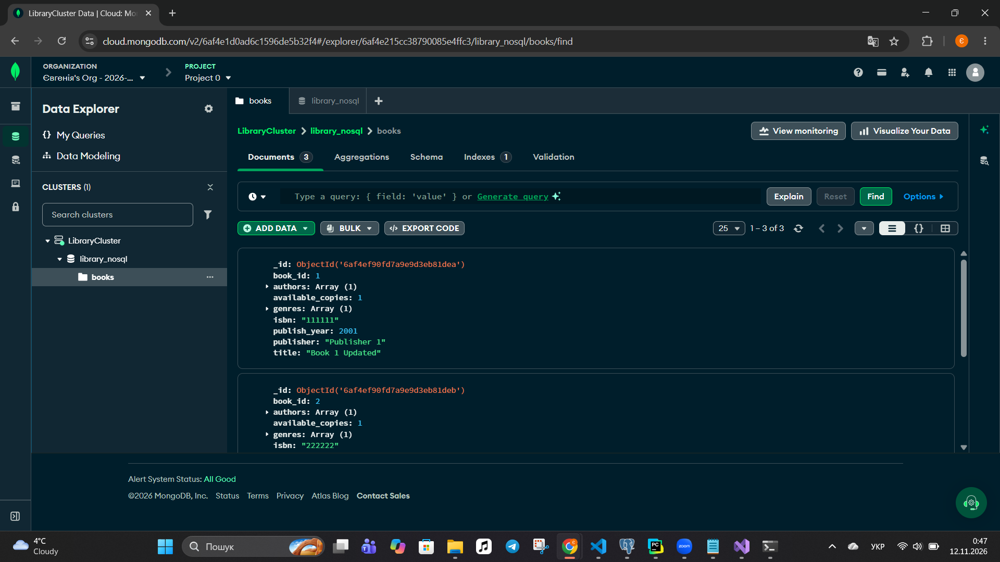

**Приклади запитів MongoDB (фільтри колекції `books`):**

```javascript
// Книга з ідентифікатором 1
{ "book_id": 1 }

// Книги, видані після 2005 року
{ "publish_year": { "$gt": 2005 } }

// Книги, які мають доступні примірники
{ "available_copies": { "$gt": 0 } }
```

<details>
<summary>Результати пошукових запитів MongoDB</summary>

**Пошук за ідентифікатором**

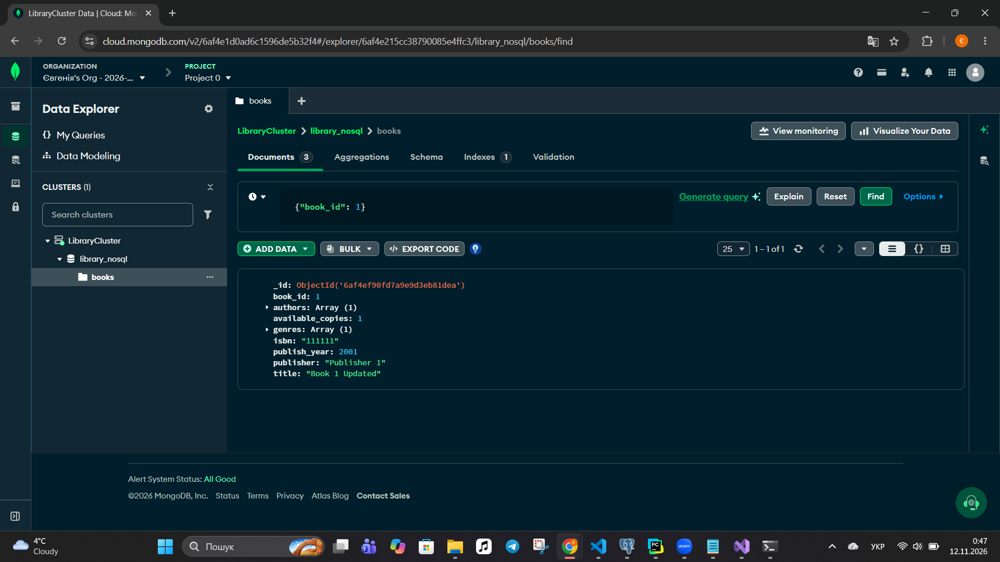

**Фільтрація за роком видання**


**Пошук доступних книг**

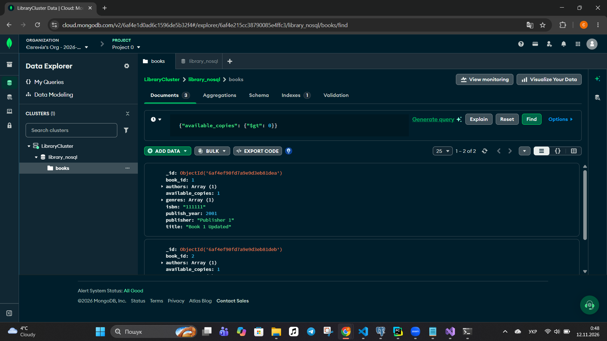

</details>

## 2. Реалізація PostgreSQL

Ті самі відомості представлені в нормалізованій реляційній схемі. Інформація про авторів, жанри, видавництва та примірники зберігається окремо й пов'язується зовнішніми ключами. Це зручно для підтримання узгодженості даних, зокрема при видачі та поверненні книг.

**Аналогічні SQL-запити:**

```sql
-- Пошук книги за ID
SELECT *
FROM books
WHERE book_id = 1 AND is_deleted = FALSE;

-- Книги після 2005 року
SELECT *
FROM books
WHERE publish_year > 2005 AND is_deleted = FALSE;

-- Книги з доступними примірниками
SELECT b.book_id, b.title, COUNT(bc.copy_id) AS available_copies
FROM books b
JOIN book_copies bc ON bc.book_id = b.book_id
WHERE bc.status = 'available'
  AND bc.is_deleted = FALSE
  AND b.is_deleted = FALSE
GROUP BY b.book_id, b.title;
```

У третьому запиті PostgreSQL підраховує наявні примірники за рядками `book_copies`, тоді як MongoDB читає попередньо збережене поле `available_copies`. Результати логічно зіставні за умови, що це поле в MongoDB актуалізоване.

<details>
<summary>Результати SQL-запитів</summary>

**Пошук за ідентифікатором**

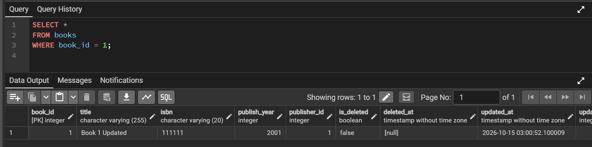

**Фільтрація за роком видання**

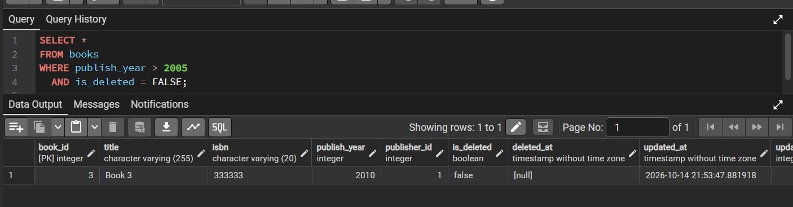

**Пошук доступних книг**

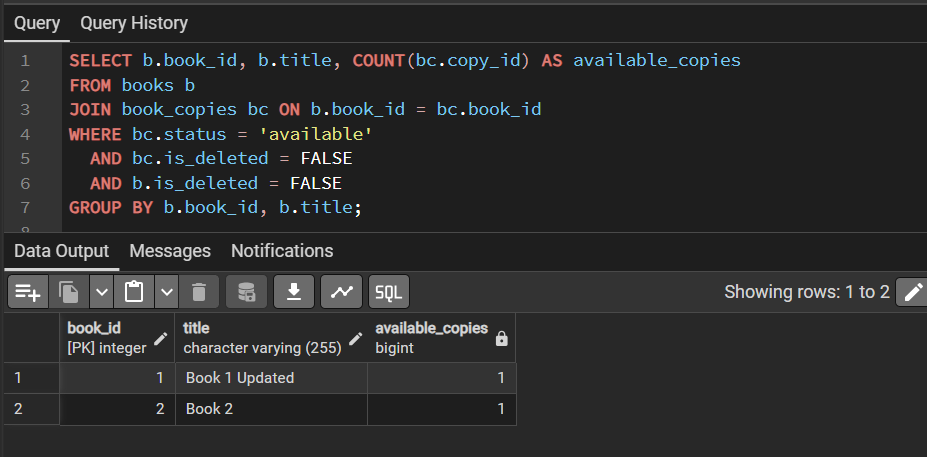

</details>

## 3. Порівняння швидкодії PostgreSQL та MongoDB

### Методика

Початкова бібліотека містила замало книг для змістовного дослідження масштабування. Тому для експерименту було згенеровано **ідентичні за значеннями набори з 1 000, 10 000 і 30 000 книг**. Їх розміщено окремо від основних даних: у таблиці PostgreSQL `benchmark_books` і в однойменній колекції MongoDB. Для порівнянних умов створено індекси на полях `book_id`, `publish_year` та `available_copies`.

Перевірялися три операції: пошук за ID, підрахунок книг після 2005 року та підрахунок книг із доступними примірниками. У PostgreSQL використано `COUNT(*)`, у MongoDB - `CountDocumentsAsync()`. Для кожної операції виконано **5 прогрівів і 30 вимірювань** з `Stopwatch` у C#. Порівнювалися середній час, медіана та кількість знайдених записів; порядок виконання запитів чергувався.

### Результати масштабування

Нижче наведено фактичний **середній час відповіді у мілісекундах** (менше - краще).

| Книг | Операція | PostgreSQL, мс | MongoDB, мс | Кількість результатів в обох БД |
|---:|---|---:|---:|---:|
| 1 000 | Пошук за ID | 0,483 | 46,967 | 1 |
| 1 000 | Після 2005 року | 0,561 | 47,495 | 537 |
| 1 000 | Доступні книги | 0,426 | 49,077 | 834 |
| 10 000 | Пошук за ID | 0,340 | 46,314 | 1 |
| 10 000 | Після 2005 року | 0,566 | 50,528 | 5 425 |
| 10 000 | Доступні книги | 0,676 | 50,527 | 8 334 |
| 30 000 | Пошук за ID | 0,357 | 47,305 | 1 |
| 30 000 | Після 2005 року | 1,155 | 55,605 | 16 283 |
| 30 000 | Доступні книги | 1,311 | 56,050 | 25 000 |

Кількість результатів у PostgreSQL та MongoDB **збіглася для кожного запиту**. Це підтверджує, що порівнювані умови на тестових наборах дають однакові результати.

<details>
<summary>Повні результати вимірювань (скриншоти)</summary>

**1 000 книг**

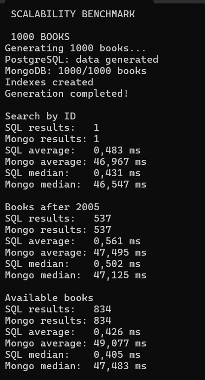

**10 000 книг**

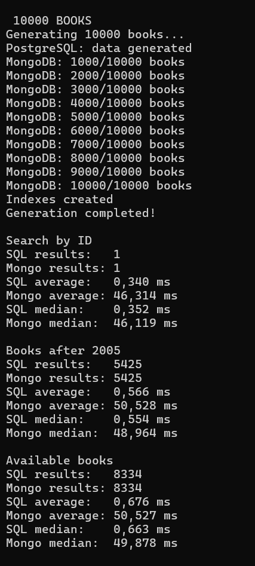

**30 000 книг**

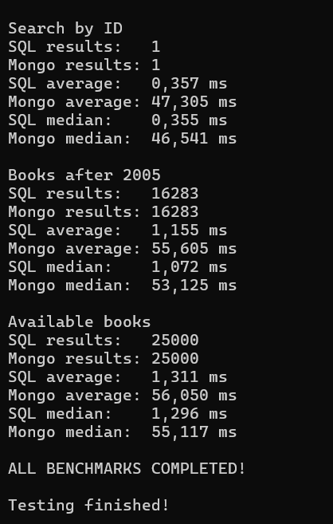

</details>

### Початкове тестування

До генерації великих наборів було також перевірено запити до початкових даних бібліотеки: 10 прогрівів і 100 повторень. На відміну від тесту масштабування, тут отримувалися рядки, а не лише їх кількість, тому ці вимірювання наведено окремо.

| Операція | PostgreSQL, мс | MongoDB, мс |
|---|---:|---:|
| Пошук за ID | 0,557 | 59,145 |
| Книги після 2005 року | 0,540 | 47,839 |
| Доступні книги | 0,514 | 47,793 |

<details>
<summary>Скриншот початкового порівняння</summary>

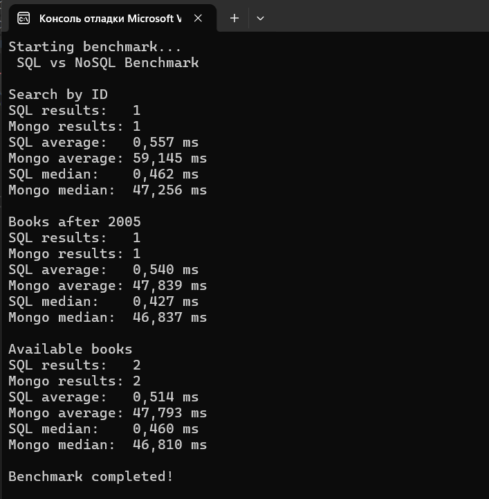

</details>

### Аналіз результатів

У всіх проведених тестах **локальна PostgreSQL мала менший виміряний час відповіді**, ніж MongoDB. Для пошуку за індексованим ID час майже не змінювався зі збільшенням обсягу даних. Для підрахунку книг за роком та доступністю час дещо зростав, особливо на 30 000 записів.

Водночас PostgreSQL працювала на локальному комп'ютері, а MongoDB - на віддаленому сервері. Час MongoDB включає мережеву затримку, тому отримані числа **не доводять загальної переваги SQL над NoSQL** і не є чистим порівнянням продуктивності серверів. Вони характеризують час відповіді за конкретної конфігурації експерименту.

## 4. Реалізація Redis

Для реалізації другого типу NoSQL обрано Redis — базу даних типу «ключ–значення». Її використано для зберігання кількості доступних примірників книг.

Для кожної книги створюється окремий ключ `library:book:{id}:available_count`, значенням якого є кількість доступних примірників. Додатково використовується множина `library:books:index` для зберігання ідентифікаторів книг.

### Реалізовані операції

| Операція | Метод | Призначення |
|---|---|---|
| Запис | `StringSetAsync` | Збереження кількості примірників |
| Читання | `StringGetAsync` | Отримання кількості примірників |
| Оновлення | `StringSetAsync` | Зміна збереженого значення |
| Видалення | `KeyDeleteAsync` | Видалення даних книги |
| Пошук | `SetMembersAsync` | Отримання ID книг із подальшою перевіркою доступності |

### Результати виконання

Під час тестування було збережено інформацію про три книги з кількістю примірників 5, 0 та 8 відповідно.

Початковий пошук повернув книги з ID 1 і 3. Після оновлення кількості примірників другої книги з 0 до 4 вона також з'явилася серед доступних.

Після видалення третьої книги повторне читання повернуло `not found`, що підтверджує успішне видалення запису.

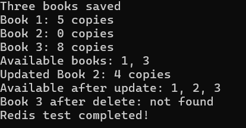

Таким чином, реалізовано основні операції з даними в Redis, а також пошук книг за наявністю доступних примірників.

## 5. Висновок

Під час лабораторної роботи реалізовано використання трьох моделей зберігання даних для бібліотеки. Основна реляційна структура залишилася в **PostgreSQL**: зв'язки між книгами, авторами, жанрами, видавництвами та примірниками представлені таблицями. У **MongoDB** сформовано документне подання каталогу, де основні відомості про книгу зберігаються разом. У **Redis** реалізовано допоміжне сховище кількості доступних примірників із читанням, оновленням, пошуком і видаленням ключів.

Однакові тестові дані та еквівалентні умови запитів дали однакову кількість результатів у PostgreSQL і MongoDB для всіх трьох масштабів - **1 000, 10 000 і 30 000 книг**. У протестованому середовищі PostgreSQL мала менший час відповіді, але основним обмеженням такого порівняння є різниця між локальним і віддаленим розміщенням баз.

Отже, доцільність NoSQL визначається не лише швидкістю запиту. MongoDB зручна для читання цілісних документів каталогу; Redis - для простих часто запитуваних значень; PostgreSQL - для взаємопов'язаних даних і операцій, що потребують узгодженості. Для спільного використання цих систем необхідно передбачати актуалізацію дубльованої інформації.
